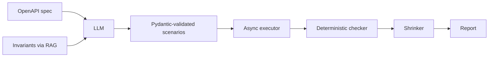

# InvariantGuard

**AI-Assisted Stateful & Concurrent API Testing for Payment Systems**


> An LLM invents tricky payment scenarios. Plain Python runs them and decides whether a business rule was broken.
> **The model proposes, the code verifies.**

---

## The problem

Payment bugs are rarely "one bad request". They show up when things happen **in a certain order** or **at the same time**:

- A customer retries a payment and gets **charged twice**.
- Two refunds of 600 arrive at once on a 1000 payment. Each looks fine alone, so the system approves **both** and refunds 1200.

Hand-written tests tend to miss these cases. InvariantGuard generates and checks them automatically.

## How it works



1. **Read the API.** The target's OpenAPI spec lists its endpoints.
2. **Retrieve the rules (RAG).** Business invariants relevant to each endpoint are pulled from `knowledge/invariants.md`.
3. **Generate scenarios (LLM).** The model returns multi-step test scenarios as JSON. Steps can save values (like a payment id) and can repeat **concurrently** to expose race conditions.
4. **Validate.** Every scenario is checked with Pydantic. Malformed output is dropped, never run.
5. **Execute.** An async executor (`httpx` + `asyncio`) runs the steps, firing concurrent requests together.
6. **Verify.** A deterministic checker, not the LLM, compares the recorded requests and responses against the invariants.
7. **Shrink.** Each failing scenario is reduced step by step to its shortest reproduction.

### Why the LLM is not the judge

An LLM can be wrong, or can talk itself into "looks fine". Here it only **suggests tests**. Whether a rule was broken is decided by ordinary code on recorded facts, so the model can never fake a pass.

## What it checks

Six invariants, enforced by the checker:

| Invariant | Meaning |
|---|---|
| `amount_must_be_positive` | zero or negative payments must be rejected |
| `idempotency_key_reuse` | the same `Idempotency-Key` must never create two payments |
| `capture_only_once` | a payment can be captured successfully only once |
| `refunds_within_amount` | total successful refunds can never exceed the payment amount |
| `refund_requires_capture` | a refund needs an earlier successful capture |
| `unknown_id_must_404` | unknown payment ids must not return a success status |

## The test target: a mock payment API with 7 planted bugs

`mock_api/app.py` is a FastAPI payment API (create, capture, refund, get). Each bug can be switched on by name, so there is ground truth for measuring the tool.

| Bug | What goes wrong |
|---|---|
| `negative_amount` | accepts amount <= 0 |
| `idempotency` | same key creates a second payment |
| `double_capture` | a payment can be captured twice |
| `refund_overflow` | refunds can exceed the payment amount |
| `refund_race` | overflow only under **concurrent** refunds (check-then-act race) |
| `refund_before_capture` | refund allowed on a payment never captured |
| `wrong_status` | unknown id returns 200 instead of 404 |

`refund_race` is the interesting one: it passes every one-request-at-a-time test and only fails when two refunds overlap. A unit test in `tests/test_core.py` demonstrates this.

## Results

Three independent runs (Gemini `gemini-3.5-flash-lite`, temperature 0.8) against the mock API. Retrieval method: word overlap (`bow`). Each run, the LLM generated about 12 scenarios per mode; the baseline is a fixed set of 5 non-LLM template tests.

**Bugs found per run (out of 7)**

| Run | Baseline (no LLM) | LLM + RAG | LLM without RAG |
|---|---|---|---|
| 1 | 2 | 7 | 4 |
| 2 | 2 | 6 | 7 |
| 3 | 2 | 7 | 4 |
| **Mean** | **2.0** | **6.7** | **5.0** |

**No false positives** on the clean API in any run.

**How often each bug was detected (out of 3 runs)**

| Bug | Baseline | LLM + RAG | LLM without RAG |
|---|---|---|---|
| negative_amount | 3 | 3 | 3 |
| idempotency | 0 | 3 | 3 |
| double_capture | 0 | 3 | 3 |
| refund_overflow | 0 | 3 | 1 |
| refund_race | 0 | 2 | 1 |
| refund_before_capture | 0 | 3 | 1 |
| wrong_status | 3 | 3 | 3 |

**Takeaways**

- LLM-generated scenarios beat the template baseline in every run, mainly because the baseline cannot produce multi-step or concurrent scenarios.
- RAG gave a higher and steadier average (6.7 vs 5.0), but run 2 went the other way. With 3 runs and 7 bugs, the RAG advantage is **suggestive, not statistically established**.

Full reports and raw results for every run are in [`out/`](out/).

### Example: a minimal reproduction the tool produced

`refund_race`, shrunk to its shortest form:

```
POST /payments                 {"amount": 1000, "currency": "INR"}
POST /payments/{pid}/capture
POST /payments/{pid}/refund    {"amount": 600}   x2 concurrently
```

Both refunds succeed, so 1200 is refunded on a 1000 payment. This violates `refunds_within_amount`.

## Quick start

```bash
pip install -r requirements.txt
python -m pytest -q                                   # 5 unit tests
python -m idemtest.run_eval --provider mock           # offline wiring check, NOT a real result
```

Real run with an LLM (set your own key; never commit it):

```powershell
# PowerShell
$env:GEMINI_API_KEY="your-key"
$env:LLM_MODEL="gemini-3.5-flash-lite"
python -m idemtest.run_eval --provider gemini --regen
```

Groq is also supported (`GROQ_API_KEY`, `--provider groq`). Model names change over time; set `LLM_MODEL` to a current one if you get a 404.

Re-run the checker on saved scenarios without calling the LLM again:

```bash
python -m idemtest.run_eval --provider gemini
```

The report is written to `out/report.md`.

## Project structure

```
mock_api/app.py         FastAPI payment API with 7 switchable bugs
idemtest/models.py      Scenario / Step / Violation (Pydantic)
idemtest/retriever.py   RAG over knowledge/invariants.md (word-overlap, or embeddings if installed)
idemtest/llm.py         one function that calls Gemini / Groq (or an offline mock)
idemtest/generator.py   prompt building, JSON validation, non-LLM baseline
idemtest/executor.py    runs scenarios, fires concurrent steps with asyncio
idemtest/checker.py     deterministic invariant checker (the only judge)
idemtest/shrink.py      reduces failures to minimal reproductions
idemtest/run_eval.py    evaluation across clean + buggy APIs, writes the report
knowledge/              the business rules used for retrieval
tests/                  unit tests
out/                    reports and raw results from the real runs
```

## Design decisions

- **Generate, execute, verify.** The LLM never sees results or decides pass/fail.
- **Fresh state per scenario.** Each scenario runs against a new app instance, so scenarios cannot influence each other.
- **In-process execution.** `httpx.ASGITransport` talks to the FastAPI app directly, so no server is needed and concurrency is real.
- **Validate everything the model returns.** Invalid scenarios are counted and dropped.
- **A non-LLM baseline.** It makes the claim "the LLM adds value" testable.

## Limitations

- The bugs and the invariants were written by the same person, so retrieval had an easy match.
- The RAG and no-RAG prompts differ in more than the retrieved rules (the RAG prompt also tells the model to try to violate them), so the comparison is not perfectly controlled.
- Small sample: 3 runs, 7 bugs. LLM output varies run to run.
- The checker covers 6 invariants. Anything outside them is not detected.
- Evaluated only on a mock API, not on real systems.
- Retrieval used simple word overlap; embedding-based retrieval is supported but was not part of these runs.

## Possible next steps

- Embedding-based retrieval (`sentence-transformers`) and a cleaner prompt ablation.
- More runs per mode, with proper statistics.
- More invariants (state-machine ordering, partial captures, currency rules).
- Run against other FastAPI services through their OpenAPI specs.
- Export failing scenarios as ready-to-run `pytest` files.

## Disclaimer

An independent learning project on a mock API. Commercial payment-testing tools exist; this explores whether RAG-grounded LLM scenarios can find stateful and concurrency logic bugs. It is not affiliated with any company and uses no real payment data.

---

Built by [Het](https://github.com/hetpatel-28).